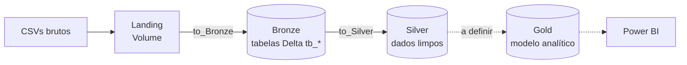

# v-credit-case

Pipeline de dados no **Databricks** para o caso de competição V-Credit. O projeto segue a **arquitetura medalhão** (Landing → Bronze → Silver → Gold), usando Unity Catalog, Delta Lake e Workflows (Jobs).

> **Estado atual:** as camadas Bronze (8 tabelas ingeridas a partir de CSVs) e Silver (8 tabelas com os dados transformados) estão implementadas. A camada Gold também foi construída utilizando modelagem dimensional (Fato e Dimensões).

---

## Sumário

- [Visão geral das camadas](#visão-geral-das-camadas)
- [Estrutura do repositório](#estrutura-do-repositório)
- [Camada Landing](#camada-landing)
- [Camada Bronze](#camada-bronze)
- [Camada Silver](#camada-silver)
- [Camada Gold](#camada-gold)
- [Como funcionam os notebooks `utils`](#como-funcionam-os-notebooks-utils)
- [Orquestração (job.yaml)](#orquestração-jobyaml)
- [Como executar](#como-executar)
- [Convenções de Git](#convenções-de-git)

---

## Visão geral das camadas



| Camada | Local no Unity Catalog | Conteúdo | Status |
|---|---|---|---|
| **Landing** | Volume `v_credit_case.bronze.landing` | Arquivos CSV exatamente como recebidos | Criada automaticamente (arquivos são enviados manualmente) |
| **Bronze** | Schema `v_credit_case.bronze` | Cópia fiel dos CSVs em tabelas Delta, com coluna de auditoria |
| **Silver** | Schema `v_credit_case.silver` | Dados limpos, tipados e padronizados |
| **Gold** | Schema `v_credit_case.gold` | Modelo analítico (Star Schema) pronto para BI |

O nome do catálogo (`v_credit_case`) é parametrizável por widget, então o mesmo código pode rodar em outro ambiente.

---

## Estrutura do repositório

```
v-credit-case/
├── README.md
├── job.yaml              # Definição do job Databricks (8 tasks Bronze)
├── to_Bronze/
│   ├── utils.ipynb          # Notebook de setup e funções compartilhadas
│   ├── atendentes.ipynb
│   ├── canais.ipynb
│   ├── chamados.ipynb
│   ├── chamados_hora.ipynb
│   ├── clientes.ipynb
│   ├── custos.ipynb
│   ├── motivos.ipynb
│   └── pesquisas_de_satisfacao.ipynb
└── to_Silver/
    └── ...          # Mesmos 9 notebooks de to_Bronze/ (utils + 8 tabelas)
└── to_Gold/
    ├── utils.ipynb
    ├── dim_atendentes.ipynb
    ├── dim_canal.ipynb
    ├── dim_clientes.ipynb
    ├── dim_horario.ipynb
    ├── dim_motivo.ipynb
    └── fato_chamados.ipynb

```
Cada tabela tem um notebook por camada. Os arquivos `.ipynb` são **notebooks do Databricks** (e não módulos Python importáveis). Eles são reutilizados com `%run`, não com `import`. (ver [Como funciona o notebook `utils`](#como-funciona-o-notebook-utils))

Todos os arquivos `.ipynb` são **notebooks do Databricks** (e não módulos Python importáveis). Eles são reutilizados com `%run`, não com `import`.

---

## Camada Landing

Os CSVs ficam no volume:

```
/Volumes/{catalog}/bronze/landing/{pasta_ou_arquivo}
```

O volume e os diretórios de checkpoint são criados automaticamente pelo notebook `utils` da Bronze. Os arquivos esperados no upload são:

| Arquivo / Origem | Tabela Bronze |
|---|---|
| `base_atendentes` / `base_atendentes.csv` | `tb_atendentes` |
| `canais` / `canais.csv` | `tb_canais` |
| `chamados` / `chamados.csv` | `tb_chamados` |
| `Chamados_Hora.CSV` | `tb_chamados_hora` |
| `clientes` / `clientes.csv` | `tb_clientes` |
| `custos` / `custos.csv` | `tb_custos` |
| `base_motivos` / `base_motivos.csv` | `tb_motivos` |
| `pesquisas_de_satisfacao` / `pesquisa_satisfacao.csv` | `tb_pesquisas_de_satisfacao` |


---

## Camada Bronze

A Bronze é uma ingestão **incremental e sem transformação de negócio**: lê em streaming apenas os CSVs novos do volume de landing, adiciona a coluna `ingestion_datetime` e grava em uma tabela Delta. Tem capacidade de alterar o `encoding` de acordo com requisição.

- **Schema:** `{catalog}.bronze`
- **Formato:** Delta
- **Modo de escrita:** `writeStream` em modo `append`, com `trigger(availableNow=True)` e `checkpointLocation` por tabela
- **Leitura do CSV:** Auto Loader (`readStream` com `cloudFiles`), CSV com `header=true` e inferência de tipos (`cloudFiles.inferColumnTypes`).
 - **Checkpointing:** Mantido em `/Volumes/{catalog}/bronze/checkpoints/{table_name}` para garantir tolerância a falhas e reprocessamento exato.
- **Colunas de auditoria:** `
    - `ingestion_datetime` (timestamp da ingestão)
    - `source_file`:  caminho do arquivo de origem
    - `_rescued_data`: adicionada automaticamente pelo Auto Loader com dados que não couberam no esquema inferido

### Por que ingestão em streaming

Os CSVs chegam ao volume de landing em cargas manuais, e o job pode ser reexecutado a qualquer momento (retentativa de uma task, rerun manual ou nova carga na mesma pasta). Com uma leitura em lote seguida de `append`, cada reexecução gravaria de novo todos os arquivos já ingeridos, e a Bronze acumularia registros repetidos.

### Reingestão do zero

Para forçar o reprocessamento completo de uma tabela na Bronze:
1. Apague a tabela Delta no catálogo (`DROP TABLE {catalog}.bronze.{table_name}`).
2. Apague a pasta de checkpoint correspondente em `/Volumes/{catalog}/bronze/checkpoints/{table_name}`.
3. Se houver mudança de esquema, apague o esquema salvo em `/Volumes/{catalog}/bronze/checkpoints/schemas/{source}`.


Cada notebook da Bronze (um por tabela) tem a mesma estrutura de três passos:

1. `%run ./utils` para configurar o ambiente e carregar as funções.
2. Cria os widgets `expected_file` e `table_name` com valores padrão.
3. Chama `load_df(expected_file)` e depois `save_df(df, table_name)`. O `load_df` devolve um DataFrame de streaming, e o `save_df` inicia o stream e aguarda o término.

---


## Camada Silver

## Camada Silver

A Silver aplica limpeza, padronização, deduplicação e tipagem sobre as tabelas Bronze.

- **Schema:** `{catalog}.silver`
- **Modo de Escrita:** `overwrite` (reconstruída integralmente a cada execução para consistência de regras).
- **Deduplicação:** Realizada via janela `row_number()` particionada pela chave de negócio e ordenada por `ingestion_datetime DESC`.
- **Qualidade de Dados:** O notebook `utils` fornece funções de Data Quality (`dq_check` e `dq_check_unique`) que validam regras de negócio registradas em logs sem parar o pipeline.

### Resumo por tabela Silver
- `tb_atendentes`: Padronização do nível de atendimento (1 e 2), tipagem de datas de admissão e desligamento.
- `tb_canais`: Padronização de nomes de canais de atendimento.
- `tb_chamados`: Consolidação dos dados estruturais dos chamados.
- `tb_chamados_hora`: Ajuste de inconsistências em timestamps (viradas de dia, ajuste de anos) e cálculo de `tempo_espera_segundos` e `tempo_atendimento_segundos`.
- `tb_clientes`: Tratamento de e-mails, validação de regiões brasileiras e limites de idade/vencimento de fatura.
- `tb_custos`: Limpeza de símbolos monetários (`R$`) e conversão para decimal.
- `tb_motivos`: Normalização de categorias e criticidade.
- `tb_pesquisas_de_satisfacao`: Tratamento e consolidação de notas e avaliações.

---
A camada Gold estrutura os dados no modelo dimensional **Star Schema** (Esquema Estrela), otimizado para consultas analíticas e ferramentas de BI (ex: Power BI).

- **Schema:** `{catalog}.gold`
- **Modo de Escrita:** Delta Lake (`overwrite` ou gerenciado por chave substituta/SK).
- **Modelagem:**
  - **Surrogate Keys (SK):** Identificadores numéricos gerados sequencialmente ou via hash para isolar o modelo dimensional das chaves de negócio das origens.
  - **Dimensões e Fato:**

| Tabela Gold | Tipo | Descrição / Conteúdo | Chave Primária (SK) |
|---|---|---|---|
| `dim_atendente` | Dimensão | Atendentes, nível de atuação e histórico de status | `atendente_sk` |
| `dim_canal` | Dimensão | Canais de atendimento oferecidos | `canal_sk` |
| `dim_cliente` | Dimensão | Cadastro de clientes, localização e dados demográficos | `cliente_sk` |
| `dim_data` | Dimensão | Calendário completo com marcação de feriados e datas comemorativas | `data_sk` |
| `dim_horario` | Dimensão | Granularidade por segundo do dia (24h), faixas de horário e indicador comercial | `horario_sk` |
| `dim_motivo` | Dimensão | Motivos de chamados, categorias e criticidades | `motivo_sk` |
| `fato_chamados` | Fato | Eventos de chamados integrando tempos, custos, nota de satisfação e SKs de dimensão | `id_chamado` |
---

## Como funcionam os notebooks `utils`

Cada camada possui seu próprio notebook `utils.ipynb` com funções e configurações globais, reutilizadas via `%run ./utils`:

### 1. `to_Bronze/utils.ipynb`
- Garante a existência do catálogo, schema `bronze` e volumes (`landing` e `checkpoints`).
- **`load_df(source, encoding="UTF-8")`**: Lê arquivos via streaming (`cloudFiles` / Auto Loader) anexando metadados do arquivo.
- **`save_df(df, table_name)`**: Executa o `writeStream` Delta em modo `append` com `availableNow=True`.

### 2. `to_Silver/utils.ipynb`
- Cria o schema `silver`.
- **`save_df(df, table_name)`**: Grava o DataFrame em modo `overwrite` com `overwriteSchema=true`.
- **`dq_check(...)` & `dq_check_unique(...)`**: Funções para validação de integridade e qualidade de dados.

### 3. `to_Gold/utils.ipynb`
- Cria o schema `gold`.
- **`add_sequential_key(...)`**: Gera Surrogate Keys (SKs) sequenciais para tabelas de dimensão.
- Helper functions para junções e tratamento de registros nulos ("Não Informado").

### Parâmetros dos notebooks

| Widget | Camada | Definido em | Padrão | Função |
|---|---|---|---|---|
| `catalog` | Bronze e Silver | `utils` | `v_credit_case` | Catálogo de destino |
| `expected_file` | Bronze | notebook da tabela | nome do CSV | Arquivo lido do volume de landing |
| `table_name` | Bronze | notebook da tabela | `tb_*` | Tabela Bronze de destino |
| `bronze_table_name` | Silver | notebook da tabela | `tb_*` | Tabela Bronze de origem |
| `silver_table_name` | Silver | notebook da tabela | `tb_*` | Tabela Silver de destino |

---

## Orquestração (job.yaml)

O arquivo `job.yaml` define o job **V-Credit-Case** (Databricks Asset Bundle / Workflows) com **13 tasks de notebook**, 8 da Bronze (uma por tabela) e 5 da Silver. As tasks da Bronze não têm dependências entre si, então **rodam em paralelo**. Cada task da Silver declara `depends_on` da task Bronze da mesma tabela, então começa assim que a ingestão correspondente termina.

Cada task passa os parâmetros  via `base_parameters`, que sobrescrevem os padrões dos widgets. 

- **Bronze:** `catalog`, `expected_file` e `table_name`.
- **Silver:** `catalog`, `bronze_table_name` e `silver_table_name`.

Configurações adicionais: fila habilitada (`queue.enabled: true`) e `performance_target: PERFORMANCE_OPTIMIZED`.

### Tasks da Bronze

| task_key | Notebook | Arquivo | Tabela |
|---|---|---|---|
| `bronze-atendentes` | `to_Bronze/atendentes` | `base_atendentes.csv` | `tb_atendentes` |
| `bronze-canais` | `to_Bronze/canais` | `canais.csv` | `tb_canais` |
| `bronze-chamados` | `to_Bronze/chamados` | `chamados.csv` | `tb_chamados` |
| `bronze-chamados-hora` | `to_Bronze/chamados_hora` | `Chamados_Hora.CSV` | `tb_chamados_hora` |
| `bronze-clientes` | `to_Bronze/clientes` | `clientes.csv` | `tb_clientes` |
| `bronze-custos` | `to_Bronze/custos` | `custos.csv` | `tb_custos` |
| `bronze-motivos` | `to_Bronze/motivos` | `base_motivos.csv` | `tb_motivos` |
| `bronze-pesquisas-de-satisfacao` | `to_Bronze/pesquisas_de_satisfacao` | `pesquisa_satisfacao.csv` | `tb_pesquisas_de_satisfacao` |

### Tasks da Silver

| task_key | Depende de | Notebook | Tabela de origem (Bronze) | Tabela de destino (Silver) |
|---|---|---|---|---|
| `silver-atendentes` | `bronze-atendentes` | `to_Silver/atendentes` | `tb_atendentes` | `tb_atendentes` |
| `silver-canais` | `bronze-canais` | `to_Silver/canais` | `tb_canais` | `tb_canais` |
| `silver-clientes` | `bronze-clientes` | `to_Silver/clientes` | `tb_clientes` | `tb_clientes` |
| `silver-custos` | `bronze-custos` | `to_Silver/custos` | `tb_custos` | `tb_custos` |
| `silver-motivos` | `bronze-motivos` | `to_Silver/motivos` | `tb_motivos` | `tb_motivos` |

---
## Como executar

1. **Clone do repositório:** Importe o repositório no Databricks Repos / Git Folders.
2. **Setup do ambiente:** Execute o notebook `to_Bronze/utils` uma única vez para provisionar o Catálogo, Schemas e Volumes no Unity Catalog.
3. **Upload de dados:** Envie os CSVs brutos para o volume `/Volumes/v_credit_case/bronze/landing/`.
4. **Execução:**
   - **Manual:** Execute individualmente os notebooks respeitando a ordem das camadas (Bronze → Silver → Gold).
   - **Automática (Workflow):** Dispare o job configurado em `job.yaml`.
5. **Validação:** Verifique as tabelas geradas no Unity Catalog dentro das camadas `v_credit_case.bronze`, `v_credit_case.silver` e `v_credit_case.gold`.

## Convenções de Git

- Cada tarefa é uma issue, e a branch carrega o número dela: `feat/<numero>-<descricao-curta>` (ex.: `feat/19-bronze-ingest-data`).
- Ao fazer um Pull Request linkado ao item, ele vai automaticamente para a coluna de Validation.
- Quando o merge é concluído, o item vai automaticamente para a coluna de Done
- Se o Pull Request tem alguma review, ele volta para In Progress
- Sempre ligue um Pull Request ao item associado!
- Sempre documentar as mudanças!
- Não incluir outputs nos commits. Databricks faz isso automaticamente.
