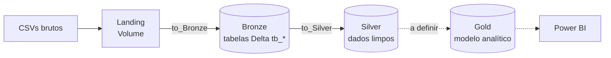

# v-credit-case

Pipeline de dados no **Databricks** para o caso de competição V-Credit. O projeto segue a **arquitetura medalhão** (Landing → Bronze → Silver → Gold), usando Unity Catalog, Delta Lake e Workflows (Jobs).

> **Estado atual:** a camada Bronze está implementada (8 tabelas ingeridas a partir de CSVs). A camada Silver tem apenas o setup de ambiente. A camada Gold ainda não foi iniciada.

---

## Sumário

- [Visão geral das camadas](#visão-geral-das-camadas)
- [Estrutura do repositório](#estrutura-do-repositório)
- [Camada Landing](#camada-landing)
- [Camada Bronze](#camada-bronze)
- [Como funciona o notebook `utils`](#como-funciona-o-notebook-utils)
- [Orquestração (job.yaml)](#orquestração-jobyaml)
- [Camada Silver](#camada-silver)
- [Como executar](#como-executar)
- [Convenções de Git](#convenções-de-git)

---

## Visão geral das camadas



| Camada | Local no Unity Catalog | Conteúdo | Status |
|---|---|---|---|
| **Landing** | Volume `v_credit_case.bronze.landing` | Arquivos CSV exatamente como recebidos | Criada automaticamente (arquivos são enviados manualmente) |
| **Bronze** | Schema `v_credit_case.bronze` | Cópia fiel dos CSVs em tabelas Delta, com coluna de auditoria | Implementada |
| **Silver** | Schema `v_credit_case.silver` | Dados limpos, tipados e padronizados | Somente setup (`utils`) |
| **Gold** | A definir | Modelo analítico para Power BI e análise | Não iniciada |

O nome do catálogo (`v_credit_case`) é parametrizável por widget, então o mesmo código pode rodar em outro ambiente.

---

## Estrutura do repositório

```
v-credit-case/
├── README.md
├── job.yaml              # Definição do job Databricks (8 tasks Bronze)
├── to_Bronze/
│   ├── utils.ipynb          # Notebook de setup e funções compartilhadas
│   ├── atendentes.ipynb
│   ├── canais.ipynb
│   ├── chamados.ipynb
│   ├── chamados_hora.ipynb
│   ├── clientes.ipynb
│   ├── custos.ipynb
│   ├── motivos.ipynb
│   └── pesquisas_de_satisfacao.ipynb
└── to_Silver/
    └── utils.ipynb          # Notebook de setup do schema Silver
```

Todos os arquivos `.ipynb` são **notebooks do Databricks** (e não módulos Python importáveis). Eles são reutilizados com `%run`, não com `import`.

---

## Camada Landing

Os CSVs ficam no volume:

```
/Volumes/{catalog}/bronze/landing
```

O volume é criado pelo `utils`, mas **o upload dos arquivos é manual**. Os nomes esperados pelo job são:

| Arquivo | Tabela Bronze |
|---|---|
| `base_atendentes.csv` | `tb_atendentes` |
| `canais.csv` | `tb_canais` |
| `chamados.csv` | `tb_chamados` |
| `Chamados_Hora.CSV` | `tb_chamados_hora` |
| `clientes.csv` | `tb_clientes` |
| `custos.csv` | `tb_custos` |
| `base_motivos.csv` | `tb_motivos` |
| `pesquisa_satisfacao.csv` | `tb_pesquisas_de_satisfacao` |

> O nome do arquivo é sensível a maiúsculas e minúsculas (note `Chamados_Hora.CSV`).

---

## Camada Bronze

A Bronze é uma ingestão **sem transformação de negócio**: lê o CSV, adiciona a coluna `ingestion_datetime` e grava em uma tabela Delta.

- **Schema:** `{catalog}.bronze`
- **Formato:** Delta
- **Modo de escrita:** `append`
- **Leitura do CSV:** `header=True` e `inferSchema=True`
- **Coluna de auditoria:** `ingestion_datetime` (timestamp da ingestão)

Cada notebook da Bronze (um por tabela) tem a mesma estrutura de três passos:

1. `%run ./utils` para configurar o ambiente e carregar as funções.
2. Cria os widgets `expected_file` e `table_name` com valores padrão.
3. Chama `load_df(expected_file)` e depois `save_df(df, table_name)`.

Exemplo (`to_Bronze/clientes.ipynb`):

```python
# MAGIC %run ./utils

dbutils.widgets.text("expected_file", "clientes.csv")
expected_file = dbutils.widgets.get("expected_file")

dbutils.widgets.text("table_name", "tb_clientes")
table_name = dbutils.widgets.get("table_name")

df = load_df(expected_file)
save_df(df, table_name)
```

---

## Como funciona o notebook `utils`

Existe um `utils` em cada camada (`to_Bronze/utils.ipynb` e `to_Silver/utils.ipynb`). Ele é um **notebook**, executado com `%run ./utils` no início de cada notebook da camada. Como o `%run` roda no mesmo contexto do notebook chamador, o `utils` enxerga `dbutils`, `spark` e os widgets, e tudo o que ele define (variáveis e funções) fica disponível no notebook que o chamou.

### `to_Bronze/utils.ipynb`

O notebook tem três células.

**1. Preâmbulo de configuração**

```python
dbutils.widgets.text("catalog", "v_credit_case")
catalog = dbutils.widgets.get("catalog")

bronze_schema = f"{catalog}.bronze"
landing_path = f"/Volumes/{catalog}/bronze/landing"

spark.sql(f"CREATE CATALOG IF NOT EXISTS {catalog}")
spark.sql(f"CREATE SCHEMA IF NOT EXISTS {bronze_schema}")
spark.sql(f"CREATE VOLUME IF NOT EXISTS {bronze_schema}.landing")
```

- Cria o widget `catalog` com padrão `v_credit_case`. Em um job, o parâmetro recebido sobrescreve o padrão.
- Define as variáveis `catalog`, `bronze_schema` e `landing_path`.
- Cria o catálogo, o schema e o volume **se ainda não existirem** (idempotente), então o primeiro run já prepara o ambiente.

**2. `load_df(file_name)`**

Lê um CSV do volume de landing e devolve um DataFrame.

- Lista a pasta `landing_path` e valida que ela existe e está acessível.
- Valida que `file_name` está na pasta. Se não estiver, lança `FileNotFoundError` com a lista dos arquivos disponíveis.
- Faz `spark.read.csv(..., header=True, inferSchema=True)`.

Qualquer falha interrompe a execução, o que faz a task do job falhar de forma explícita.

**3. `save_df(df, table_name)`**

Grava o DataFrame na Bronze.

- Adiciona `ingestion_datetime = current_timestamp()`.
- Escreve em Delta no modo `append` em `{bronze_schema}.{table_name}`, criando a tabela se ela não existir.

### `to_Silver/utils.ipynb`

Versão enxuta, por enquanto só com o preâmbulo: widget `catalog`, variável `silver_schema = "{catalog}.silver"` e criação do catálogo e do schema Silver. Ainda **não há funções compartilhadas** (equivalentes ao `load_df` e `save_df`).

### Parâmetros dos notebooks

| Widget | Definido em | Padrão | Função |
|---|---|---|---|
| `catalog` | `utils` | `v_credit_case` | Catálogo de destino |
| `expected_file` | notebook da tabela | nome do CSV | Arquivo lido do volume de landing |
| `table_name` | notebook da tabela | `tb_*` | Tabela Bronze de destino |

---

## Orquestração (job.yaml)

O arquivo `job.yaml` define o job **V-Credit-Case** (Databricks Asset Bundle / Workflows) com **8 tasks de notebook**, uma para cada tabela Bronze. Elas não têm dependências entre si, então **rodam em paralelo**.

Cada task passa os parâmetros `catalog`, `expected_file` e `table_name` via `base_parameters`, que sobrescrevem os padrões dos widgets. Configurações adicionais: fila habilitada (`queue.enabled: true`) e `performance_target: PERFORMANCE_OPTIMIZED`.

| task_key | Notebook | Arquivo | Tabela |
|---|---|---|---|
| `bronze-atendentes` | `to_Bronze/atendentes` | `base_atendentes.csv` | `tb_atendentes` |
| `bronze-canais` | `to_Bronze/canais` | `canais.csv` | `tb_canais` |
| `bronze-chamados` | `to_Bronze/chamados` | `chamados.csv` | `tb_chamados` |
| `bronze-chamados-hora` | `to_Bronze/chamados_hora` | `Chamados_Hora.CSV` | `tb_chamados_hora` |
| `bronze-clientes` | `to_Bronze/clientes` | `clientes.csv` | `tb_clientes` |
| `bronze-custos` | `to_Bronze/custos` | `custos.csv` | `tb_custos` |
| `bronze-motivos` | `to_Bronze/motivos` | `base_motivos.csv` | `tb_motivos` |
| `bronze-pesquisas-de-satisfacao` | `to_Bronze/pesquisas_de_satisfacao` | `pesquisa_satisfacao.csv` | `tb_pesquisas_de_satisfacao` |

---

## Camada Silver

Em construção. Hoje existe apenas `to_Silver/utils.ipynb` (setup do schema `{catalog}.silver`). A primeira frente de trabalho é a limpeza da base de motivos (branch `16-silver-limpar-base-de-motivos`).

---

## Como executar

1. **Clonar o repositório** em um Git folder do Databricks (Repos).
2. **Rodar `to_Bronze/utils` uma vez** para criar o catálogo, o schema e o volume.
3. **Enviar os CSVs** para `/Volumes/v_credit_case/bronze/landing`, com os nomes da tabela acima.
4. **Executar:**
   - Um notebook isolado (por exemplo, `to_Bronze/clientes`), ou
   - O job **V-Credit-Case** completo, que roda as 8 ingestões em paralelo.
5. **Conferir as tabelas** em `v_credit_case.bronze`.

Para usar outro catálogo, passe o parâmetro `catalog` no job ou altere o widget no notebook.

---

## Convenções de Git

- Cada tarefa é uma issue, e a branch carrega o número dela: `feat/<numero>-<descricao-curta>` (ex.: `feat/19-bronze-ingest-data`).
- Ao fazer um Pull Request linkado ao item, ele vai automaticamente para a coluna de Validation.
- Quando o merge é concluído, o item vai automaticamente para a coluna de Done
- Se o Pull Request tem alguma review, ele volta para In Progress
- Sempre ligue um Pull Request ao item associado!
- Sempre documentar as mudanças!
- Não incluir outputs nos commits. Databricks faz isso automaticamente.
