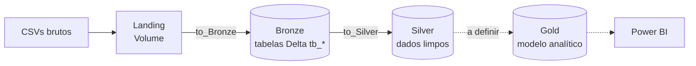

# v-credit-case

Pipeline de dados no **Databricks** para o caso de competição V-Credit. O projeto segue a **arquitetura medalhão** (Landing → Bronze → Silver → Gold), usando Unity Catalog, Delta Lake e Workflows (Jobs).

> **Estado atual:** a camada Bronze (8 tabelas ingeridas a partir de CSVs) e a camada Silver (8 tabelas com os dados transformados) estão implementadas. A camada Gold tem apenas o setup de ambiente.

---

## Sumário

- [Visão geral das camadas](#visão-geral-das-camadas)
- [Estrutura do repositório](#estrutura-do-repositório)
- [Camada Landing](#camada-landing)
- [Camada Bronze](#camada-bronze)
- [Como funciona o notebook `utils`](#como-funciona-o-notebook-utils)
- [Orquestração (job.yaml)](#orquestração-jobyaml)
- [Camada Silver](#camada-silver)
- [Como executar](#como-executar)
- [Convenções de Git](#convenções-de-git)

---

## Visão geral das camadas



| Camada | Local no Unity Catalog | Conteúdo | Status |
|---|---|---|---|
| **Landing** | Volume `v_credit_case.bronze.landing` | Arquivos CSV exatamente como recebidos | Criada automaticamente (arquivos são enviados manualmente) |
| **Bronze** | Schema `v_credit_case.bronze` | Cópia fiel dos CSVs em tabelas Delta, com coluna de auditoria | Implementada |
| **Silver** | Schema `v_credit_case.silver` | Dados limpos, tipados e padronizados | Implementada |
| **Gold** | A definir | Modelo analítico para Power BI e análise | Somente setup (`utils`) |

O nome do catálogo (`v_credit_case`) é parametrizável por widget, então o mesmo código pode rodar em outro ambiente.

---

## Estrutura do repositório

```
v-credit-case/
├── README.md
├── job.yaml              # Definição do job Databricks (8 tasks Bronze)
├── to_Bronze/
│   ├── utils.ipynb          # Notebook de setup e funções compartilhadas
│   ├── atendentes.ipynb
│   ├── canais.ipynb
│   ├── chamados.ipynb
│   ├── chamados_hora.ipynb
│   ├── clientes.ipynb
│   ├── custos.ipynb
│   ├── motivos.ipynb
│   └── pesquisas_de_satisfacao.ipynb
└── to_Silver/
    └── ...          # Mesmos 9 notebooks de to_Bronze/ (utils + 8 tabelas)
```
Cada tabela tem um notebook por camada, com o mesmo nome em `to_Bronze/` e `to_Silver/`. Já o `utils.ipynb` é específico de cada camada (ver [Como funciona o notebook `utils`](#como-funciona-o-notebook-utils))

Todos os arquivos `.ipynb` são **notebooks do Databricks** (e não módulos Python importáveis). Eles são reutilizados com `%run`, não com `import`.

---

## Camada Landing

Os CSVs ficam no volume:

```
/Volumes/{catalog}/bronze/landing
```

O volume é criado pelo `utils`, mas **o upload dos arquivos é manual**. Os nomes esperados pelo job são:

| Arquivo | Tabela Bronze |
|---|---|
| `base_atendentes.csv` | `tb_atendentes` |
| `canais.csv` | `tb_canais` |
| `chamados.csv` | `tb_chamados` |
| `Chamados_Hora.CSV` | `tb_chamados_hora` |
| `clientes.csv` | `tb_clientes` |
| `custos.csv` | `tb_custos` |
| `base_motivos.csv` | `tb_motivos` |
| `pesquisa_satisfacao.csv` | `tb_pesquisas_de_satisfacao` |

> O nome do arquivo é sensível a maiúsculas e minúsculas (note `Chamados_Hora.CSV`).

---

## Camada Bronze

A Bronze é uma ingestão **sem transformação de negócio**: lê o CSV, adiciona a coluna `ingestion_datetime` e grava em uma tabela Delta.

- **Schema:** `{catalog}.bronze`
- **Formato:** Delta
- **Modo de escrita:** `append`
- **Leitura do CSV:** `header=True` e `inferSchema=True`
- **Coluna de auditoria:** `ingestion_datetime` (timestamp da ingestão)

Cada notebook da Bronze (um por tabela) tem a mesma estrutura de três passos:

1. `%run ./utils` para configurar o ambiente e carregar as funções.
2. Cria os widgets `expected_file` e `table_name` com valores padrão.
3. Chama `load_df(expected_file)` e depois `save_df(df, table_name)`.

Exemplo (`to_Bronze/clientes.ipynb`):

```python
# MAGIC %run ./utils

dbutils.widgets.text("expected_file", "clientes.csv")
expected_file = dbutils.widgets.get("expected_file")

dbutils.widgets.text("table_name", "tb_clientes")
table_name = dbutils.widgets.get("table_name")

df = load_df(expected_file)
save_df(df, table_name)
```

---

## Como funciona o notebook `utils`

Existe um `utils` em cada camada (`to_Bronze/utils.ipynb` e `to_Silver/utils.ipynb`). Ele é um **notebook**, executado com `%run ./utils` no início de cada notebook da camada. Como o `%run` roda no mesmo contexto do notebook chamador, o `utils` enxerga `dbutils`, `spark` e os widgets, e tudo o que ele define (variáveis e funções) fica disponível no notebook que o chamou.

### `to_Bronze/utils.ipynb`

O notebook tem três células.

**1. Preâmbulo de configuração**

```python
dbutils.widgets.text("catalog", "v_credit_case")
catalog = dbutils.widgets.get("catalog")

bronze_schema = f"{catalog}.bronze"
landing_path = f"/Volumes/{catalog}/bronze/landing"

spark.sql(f"CREATE CATALOG IF NOT EXISTS {catalog}")
spark.sql(f"CREATE SCHEMA IF NOT EXISTS {bronze_schema}")
spark.sql(f"CREATE VOLUME IF NOT EXISTS {bronze_schema}.landing")
```

- Cria o widget `catalog` com padrão `v_credit_case`. Em um job, o parâmetro recebido sobrescreve o padrão.
- Define as variáveis `catalog`, `bronze_schema` e `landing_path`.
- Cria o catálogo, o schema e o volume **se ainda não existirem** (idempotente), então o primeiro run já prepara o ambiente.

**2. `load_df(file_name)`**

Lê um CSV do volume de landing e devolve um DataFrame.

- Lista a pasta `landing_path` e valida que ela existe e está acessível.
- Valida que `file_name` está na pasta. Se não estiver, lança `FileNotFoundError` com a lista dos arquivos disponíveis.
- Faz `spark.read.csv(..., header=True, inferSchema=True)`.

Qualquer falha interrompe a execução, o que faz a task do job falhar de forma explícita.

**3. `save_df(df, table_name)`**

Grava o DataFrame na Bronze.

- Adiciona `ingestion_datetime = current_timestamp()`.
- Escreve em Delta no modo `append` em `{bronze_schema}.{table_name}`, criando a tabela se ela não existir.

### `to_Silver/utils.ipynb`

O notebook tem cinco células. Assim como na Bronze, é executado com `%run ./utils` no início de cada notebook da camada, e as variáveis e funções definidas nele ficam disponíveis no notebook chamador.

**1. Preâmbulo de configuração**

Funciona de forma semelhante ao preâmbulo da Bronze: cria o widget `catalog`, define as variáveis de schema (`bronze_schema` e `silver_schema`) e cria o catálogo e os dois schemas **se ainda não existirem**. Também importa `pyspark.sql.functions` como `F`, necessário para as funções do `utils`. Imports adicionais (como `Window`) ficam em cada notebook.

**2. `save_df(df, table_name)`**

Grava o DataFrame na Silver.

- Escreve em Delta no modo `overwrite` em `{silver_schema}.{table_name}`, com `overwriteSchema=true`.
- A tabela é **reconstruída por completo a cada execução**, a partir do que está na Bronze. Esse é o contraste com a Bronze, que usa `append`.
- Com `overwriteSchema`, mudanças de colunas e tipos no tratamento são refletidas na tabela sem etapa manual.

**3. `dq_check(table_name, check_name, df, condition)`**

Checagem de qualidade baseada em uma condição esperada.

- Recebe a tabela e o nome da checagem (usados na mensagem) e uma condição do Spark que **toda linha deve satisfazer**, por exemplo `F.col("valor") > 0`.
- Conta o total de linhas e quantas violam a condição.
- Imprime no log uma linha no formato `[PASS|FAIL] tabela | checagem | X/Y linhas falharam`. O status é `PASS` quando nenhuma linha falha.

**4. `dq_check_unique(table_name, check_name, df, key_cols)`**

Checagem de qualidade específica para unicidade de chave.

- Recebe a lista de colunas que formam a chave (`key_cols`).
- Agrupa por essas colunas e conta quantas chaves aparecem mais de uma vez.
- Imprime no log `[PASS|FAIL] tabela | checagem | X chaves duplicadas de Y linhas`. O status é `PASS` quando não há chaves duplicadas.

**5. `cast_id_to_string(df, prefix="^id(_|$)")`**

Converte para `string` as colunas de identificador do DataFrame, padronizando o tipo dos ids entre as tabelas (por exemplo, para que as chaves de junção tenham o mesmo tipo dos dois lados). As colunas são selecionadas pelo nome, e as demais permanecem inalteradas.

### Parâmetros dos notebooks

| Widget | Camada | Definido em | Padrão | Função |
|---|---|---|---|---|
| `catalog` | Bronze e Silver | `utils` | `v_credit_case` | Catálogo de destino |
| `expected_file` | Bronze | notebook da tabela | nome do CSV | Arquivo lido do volume de landing |
| `table_name` | Bronze | notebook da tabela | `tb_*` | Tabela Bronze de destino |
| `bronze_table_name` | Silver | notebook da tabela | `tb_*` | Tabela Bronze de origem |
| `silver_table_name` | Silver | notebook da tabela | `tb_*` | Tabela Silver de destino |

---

## Orquestração (job.yaml)

O arquivo `job.yaml` define o job **V-Credit-Case** (Databricks Asset Bundle / Workflows) com **8 tasks de notebook**, uma para cada tabela Bronze. Elas não têm dependências entre si, então **rodam em paralelo**.

Cada task passa os parâmetros `catalog`, `expected_file` e `table_name` via `base_parameters`, que sobrescrevem os padrões dos widgets. Configurações adicionais: fila habilitada (`queue.enabled: true`) e `performance_target: PERFORMANCE_OPTIMIZED`.

| task_key | Notebook | Arquivo | Tabela |
|---|---|---|---|
| `bronze-atendentes` | `to_Bronze/atendentes` | `base_atendentes.csv` | `tb_atendentes` |
| `bronze-canais` | `to_Bronze/canais` | `canais.csv` | `tb_canais` |
| `bronze-chamados` | `to_Bronze/chamados` | `chamados.csv` | `tb_chamados` |
| `bronze-chamados-hora` | `to_Bronze/chamados_hora` | `Chamados_Hora.CSV` | `tb_chamados_hora` |
| `bronze-clientes` | `to_Bronze/clientes` | `clientes.csv` | `tb_clientes` |
| `bronze-custos` | `to_Bronze/custos` | `custos.csv` | `tb_custos` |
| `bronze-motivos` | `to_Bronze/motivos` | `base_motivos.csv` | `tb_motivos` |
| `bronze-pesquisas-de-satisfacao` | `to_Bronze/pesquisas_de_satisfacao` | `pesquisa_satisfacao.csv` | `tb_pesquisas_de_satisfacao` |

---

## Camada Silver

A Silver é a camada de **tratamento dos dados**: lê cada tabela da Bronze, corrige tipos, trata nulos e textos, resolve inconsistências, remove duplicatas, aplica regras de negócio pontuais e grava o resultado em uma tabela Delta, reconstruída a cada execução.

- **Schema:** `{catalog}.silver`
- **Origem:** tabelas Delta de `{catalog}.bronze` 
- **Formato:** Delta
- **Modo de escrita:** `overwrite` 
- **Regras de negócio:**
  - `atendentes`: categorização dos atendentes por nível de atendimento
  - `chamados_hora`: cálculo do tempo de espera e do tempo de atendimento

Cada notebook da camada Silver segue, em geral, as mesmas etapas:

1. `%run ./utils` para configurar o ambiente e carregar as funções.
2. Cria o widget `bronze_table_name` (padrão `tb_*`) e lê a tabela correspondente de `{catalog}.bronze`, selecionando as colunas de interesse e `ingestion_datetime`.
3. **Deduplicação:** mantém apenas o registro mais recente de cada chave primária, usando `row_number()` sobre uma janela particionada pela chave e ordenada por `ingestion_datetime` decrescente. Depois do filtro, `rn` e `ingestion_datetime` são descartadas, então as tabelas Silver não têm coluna de auditoria.
4. **Transformações específicas** de cada tabela: conversão de tipos, limpeza de texto, correção de inconsistências e regras de negócio (ver tabela abaixo).
5. Cria o widget `silver_table_name` (padrão `tb_*`) e chama `save_df(df, silver_table_name)`.

### Resumo por tabela

| Tabela Silver | Chave de deduplicação | Regra de negócio | Checagens |
|---|---|---|---|
| `tb_atendentes` | `id_atendente` (a confirmar) | Padronização do nível de atendimento (`1` ou `2`) | Sim (3) |
| `tb_canais` | `id_canal` | Nenhuma | Não |
| `tb_chamados` | a preencher | a preencher | a preencher |
| `tb_chamados_hora` | `id_chamado` (a confirmar) | Tempos de espera e de atendimento, em segundos | Não |
| `tb_clientes` | `id_cliente` | Nenhuma | Sim (2) |
| `tb_custos` | `id_custo` ou (`id_chamado`, `id_custo`) (a confirmar) | Nenhuma | Sim (2) |
| `tb_motivos` | `id_motivo` | Nenhuma | Não |
| `tb_pesquisas_de_satisfacao` | a preencher | a preencher | a preencher |

As checagens (`dq_check` e `dq_check_unique`) apenas registram `PASS` ou `FAIL` no log e não interrompem a execução do notebook. Cada notebook posiciona as checagens conforme o que quer medir: antes do tratamento (para medir o problema na origem) ou depois (para validar o resultado).

### Tratamentos por tabela

#### `tb_atendentes`
- **Chave:** `id_atendente` (a confirmar)
- **Tipos:** `id_atendente` → `string`
- **Limpeza:** `nivel_atendimento` padronizado: "1" e "Nível 1" → `1`; "2", "Nível 2" e "N2" → `2`; demais valores permanecem como estão
- **Regra de negócio:** padronização do nível de atendimento em dois níveis (`1` e `2`)
- **Checagens (`dq_check`):**
  - níveis de atendimento devem estar padronizados
  - data de desligamento deve ser posterior à data de admissão
  - `status_atendente = "inativo"` só é permitido após o desligamento (conferir o valor exato no código)

#### `tb_canais`
- **Chave:** `id_canal`
- **Tipos:** `id_canal` → `string`
- **Limpeza:** nenhuma
- **Checagens:** nenhuma

#### `tb_chamados`
- a preencher

#### `tb_chamados_hora`
- **Chave:** `id_chamado` (a confirmar)
- **Tipos:** `id_chamado` e `id_cliente` → `string`; colunas de hora → `timestamp`
- **Limpeza:**
  - colunas renomeadas para minúsculas (`ID_Chamado` → `id_chamado`, `ID_Cliente` → `id_cliente`)
  - correção do ano de `hora_abertura_chamado` com base na hora de início (ou de finalização, se o início for nulo), quando dia e mês coincidem
  - soma de 1 dia à finalização quando ela é anterior ao início (virada de meia-noite)
- **Regra de negócio:** `tempo_espera_segundos` (início − abertura) e `tempo_atendimento_segundos` (finalização − início)
- **Checagens:** nenhuma

#### `tb_clientes`
- **Chave:** `id_cliente`
- **Tipos:** `id_cliente` → `string`; `idade` → `int`; `data_cadastro` → `date` (`dd/MM/yyyy` ou `yyyy-MM-dd`); `dia_vencimento_fatura` → `int`
- **Limpeza:**
  - `nome`: `trim` + `upper`
  - `email`: sem espaços, em maiúsculas, `@` recuperado quando o domínio é conhecido, `NULL` se inválido (flag `email_corrigido`)
  - `regiao`: validada contra as 5 regiões do Brasil (`NULL` se inválida)
  - `idade`: válida entre 18 e 110 (`NULL` fora disso)
  - `dia_vencimento_fatura`: válido entre 1 e 28 (`NULL` fora disso)
- **Checagens (`dq_check`, antes do tratamento):** `idade` nula na origem; `idade` fora do intervalo de 18 a 110

#### `tb_custos`
- **Chave:** `id_custo` ou (`id_chamado`, `id_custo`) (a confirmar)
- **Tipos:** `id_custo` e `id_chamado` → `string`; `custo` → `decimal(18,2)`
- **Limpeza:** `custo` sem texto de moeda (`R$`, `real`, `reais`) e com vírgula decimal trocada por ponto; valores negativos preservados
- **Checagens:** `dq_check_unique` da chave composta (`id_chamado`, `id_custo`); `dq_check` de preservação dos custos negativos

#### `tb_motivos`
- **Chave:** `id_motivo`
- **Tipos:** `id_motivo` → `string`
- **Limpeza:**
  - `categoria` e `criticidade`: `trim` + `upper`
  - `categoria` reclassificada para `CARTAO` ("Contratação de cartão adicional") e `CADASTRAL` ("Transferência de agência", "Cancelamento de conta")
- **Checagens:** nenhuma

#### `tb_pesquisas_de_satisfacao`
- a preencher
---

## Como executar

1. **Clonar o repositório** em um Git folder do Databricks (Repos).
2. **Rodar `to_Bronze/utils` uma vez** para criar o catálogo, o schema e o volume.
3. **Enviar os CSVs** para `/Volumes/v_credit_case/bronze/landing`, com os nomes da tabela acima.
4. **Executar:**
   - Um notebook isolado (por exemplo, `to_Bronze/clientes`), ou
   - O job **V-Credit-Case** completo, que roda as 8 ingestões em paralelo.
5. **Conferir as tabelas** em `v_credit_case.bronze`.

Para usar outro catálogo, passe o parâmetro `catalog` no job ou altere o widget no notebook.

---

## Convenções de Git

- Cada tarefa é uma issue, e a branch carrega o número dela: `feat/<numero>-<descricao-curta>` (ex.: `feat/19-bronze-ingest-data`).
- Ao fazer um Pull Request linkado ao item, ele vai automaticamente para a coluna de Validation.
- Quando o merge é concluído, o item vai automaticamente para a coluna de Done
- Se o Pull Request tem alguma review, ele volta para In Progress
- Sempre ligue um Pull Request ao item associado!
- Sempre documentar as mudanças!
- Não incluir outputs nos commits. Databricks faz isso automaticamente.
