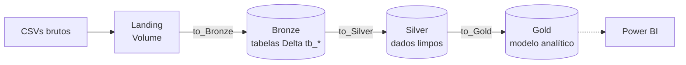

# v-credit-case

Pipeline de dados no **Databricks** para o caso de competição V-Credit. O projeto segue a **arquitetura medalhão** (Landing → Bronze → Silver → Gold), usando Unity Catalog, Delta Lake e Workflows (Jobs).

> **Estado atual:** as camadas Bronze (8 tabelas ingeridas a partir de CSVs) e Silver (8 tabelas com os dados transformados) estão implementadas. A camada Gold também foi construída utilizando modelagem dimensional (Fato e Dimensões).

---

## Sumário

- [Visão geral das camadas](#visão-geral-das-camadas)
- [Estrutura do repositório](#estrutura-do-repositório)
- [Camada Landing](#camada-landing)
- [Camada Bronze](#camada-bronze)
- [Como funciona o notebook `utils`](#como-funciona-o-notebook-utils)
- [Camada Silver](#camada-silver)
- [Camada Gold](#camada-gold)
- [Orquestração (job.yaml)](#orquestração-jobyaml)
- [Como executar](#como-executar)
- [Convenções de Git](#convenções-de-git)

---

## Visão geral das camadas



| Camada | Local no Unity Catalog | Conteúdo |
|---|---|---|
| **Landing** | Volume `v_credit_case.bronze.landing` | Arquivos CSV exatamente como recebidos |
| **Bronze** | Schema `v_credit_case.bronze` | Cópia fiel dos CSVs em tabelas Delta, com coluna de auditoria |
| **Silver** | Schema `v_credit_case.silver` | Dados limpos, tipados e padronizados |
| **Gold** | Schema `v_credit_case.gold` | Modelo analítico (Star Schema) pronto para BI |

O nome do catálogo (`v_credit_case`) é parametrizável por widget, então o mesmo código pode rodar em outro ambiente.

---

## Estrutura do repositório

```
v-credit-case/
├── README.md
├── job.yaml              # Definição do job Databricks (Workflows)
├── to_Bronze/
│   ├── utils.ipynb          # Notebook de setup e funções compartilhadas
│   ├── atendentes.ipynb
│   ├── canais.ipynb
│   ├── chamados.ipynb
│   ├── chamados_hora.ipynb
│   ├── clientes.ipynb
│   ├── custos.ipynb
│   ├── motivos.ipynb
│   └── pesquisas_de_satisfacao.ipynb
├── to_Silver/
│   └── ...                  # Mesmos notebooks de to_Bronze/ (utils + 8 tabelas)
└── to_Gold/
    ├── utils.ipynb
    ├── dim_atendentes.ipynb
    ├── dim_canal.ipynb
    ├── dim_clientes.ipynb
    ├── dim_horario.ipynb
    ├── dim_motivo.ipynb
    └── fato_chamados.ipynb
```
Cada tabela tem um notebook por camada. Os arquivos `.ipynb` são **notebooks do Databricks** (e não módulos Python importáveis). Eles são reutilizados com `%run`, não com `import`.

---

## Camada Landing

Os CSVs ficam no volume:

```
/Volumes/{catalog}/bronze/landing
```

O volume é criado pelo `utils`, mas **o upload dos arquivos é manual**. Os nomes esperados pelo job são:

| Arquivo | Tabela Bronze |
|---|---|
| `base_atendentes.csv` | `tb_atendentes` |
| `canais.csv` | `tb_canais` |
| `chamados.csv` | `tb_chamados` |
| `Chamados_Hora.CSV` | `tb_chamados_hora` |
| `clientes.csv` | `tb_clientes` |
| `custos.csv` | `tb_custos` |
| `base_motivos.csv` | `tb_motivos` |
| `pesquisa_satisfacao.csv` | `tb_pesquisas_de_satisfacao` |

> O nome do arquivo é sensível a maiúsculas e minúsculas (note `Chamados_Hora.CSV`).

---

## Camada Bronze

A Bronze é uma ingestão sem transformação de negócio: lê os CSVs do volume de landing, adiciona a coluna `ingestion_datetime` e grava em uma tabela Delta.

- **Schema:** `{catalog}.bronze`
- **Formato:** Delta
- **Modo de escrita:** Batch usando `write.format("delta").mode("append")`
- **Leitura do CSV:** Leitura em lote (`spark.read.csv`) com `header=True` e inferência de tipos (`inferSchema=True`)
- **Colunas de auditoria:** 
    - `ingestion_datetime` (timestamp exato da ingestão)

### Comportamento de Ingestão e Duplicatas

A ingestão atual é executada em lote (batch) com uma operação de append. Isso significa que **não há controle de estado ou checkpoints na camada Bronze**.

| Situação | Tratamento |
|---|---|
| Mesmo arquivo processado novamente | Ingerido novamente (gera duplicatas na Bronze) |
| Arquivo substituído com o mesmo nome | Ingerido por completo (gera duplicatas na Bronze) |
| Linhas repetidas dentro de um arquivo | Mantidas (a Bronze é cópia fiel) |

Como a ingestão apenas empilha (`append`) os dados a cada execução, reexecutar uma task fará com que o arquivo inteiro seja lido e salvo novamente. A garantia de unicidade e a deduplicação dos registros são responsabilidades delegadas inteiramente à **camada Silver**, que filtra as duplicatas mantendo apenas o registro mais recente.

### Reingestão do zero

Para reingerir um arquivo desde o início, basta aplicar um comando de `TRUNCATE` ou `DROP` na tabela Bronze correspondente. Não há necessidade de limpar pastas de checkpoint, pois a ingestão atual não utiliza esse mecanismo.

Cada notebook da Bronze (um por tabela) tem a mesma estrutura de três passos:

1. `%run ./utils` para configurar o ambiente e carregar as funções.
2. Cria os widgets `expected_file` e `table_name` com valores padrão.
3. Chama `load_df(expected_file)` e depois `save_df(df, table_name)`. O `load_df` devolve um DataFrame, e o `save_df` executa a gravação.

Exemplo (`to_Bronze/clientes.ipynb`):

```python
# MAGIC %run ./utils

dbutils.widgets.text("expected_file", "clientes.csv")
expected_file = dbutils.widgets.get("expected_file")

dbutils.widgets.text("table_name", "tb_clientes")
table_name = dbutils.widgets.get("table_name")

df = load_df(expected_file)
save_df(df, table_name)
```

---

## Como funciona o notebook `utils`

Existe um `utils` em cada camada (`to_Bronze/utils.ipynb` e `to_Silver/utils.ipynb`). Ele é um **notebook**, executado com `%run ./utils` no início de cada notebook da camada. Como o `%run` roda no mesmo contexto do notebook chamador, o `utils` enxerga `dbutils`, `spark` e os widgets, e tudo o que ele define (variáveis e funções) fica disponível no notebook que o chamou.

### `to_Bronze/utils.ipynb`

O notebook tem três células.

**1. Preâmbulo de configuração**

```python
dbutils.widgets.text("catalog", "v_credit_case")
catalog = dbutils.widgets.get("catalog")

bronze_schema = f"{catalog}.bronze"
landing_path = f"/Volumes/{catalog}/bronze/landing"

spark.sql(f"CREATE CATALOG IF NOT EXISTS {catalog}")
spark.sql(f"CREATE SCHEMA IF NOT EXISTS {bronze_schema}")
spark.sql(f"CREATE VOLUME IF NOT EXISTS {bronze_schema}.landing")

print("Catálogo configurado com sucesso!")
```

- Cria o widget `catalog` com padrão `v_credit_case`. Em um job, o parâmetro recebido sobrescreve o padrão.
- Define as variáveis `catalog`, `bronze_schema` e `landing_path`.
- Cria o catálogo, o schema e o volume **se ainda não existirem** (idempotente), imprimindo uma mensagem de sucesso ao final.

**2. `load_df(file_name)`**

Lê um CSV do volume de landing e devolve um DataFrame de lote (batch).

- Lista a pasta `landing_path` e valida se o arquivo esperado existe na lista.
- Se a pasta não estiver acessível ou o arquivo não for encontrado, lança um erro (`FileNotFoundError`) informando os arquivos disponíveis.
- Retorna a leitura usando `spark.read.csv` com as opções `header=True` e `inferSchema=True`.

Qualquer falha interrompe a execução, o que faz a task do job falhar de forma explícita.

**3. `save_df(df, table_name)`**

Grava o DataFrame na Bronze.

- Adiciona a coluna `ingestion_datetime = current_timestamp()` importada do `pyspark.sql.functions`.
- Escreve em formato Delta no modo `append` em `{bronze_schema}.{table_name}`, criando a tabela se ela não existir e salvando-a diretamente no catálogo gerenciado.

### `to_Silver/utils.ipynb`

O notebook tem cinco células. Assim como na Bronze, é executado com `%run ./utils` no início de cada notebook da camada.

**1. Preâmbulo de configuração**
Cria o widget `catalog`, define as variáveis de schema (`bronze_schema` e `silver_schema`) e cria o catálogo e os dois schemas **se ainda não existirem**. Também importa `pyspark.sql.functions` como `F`.

**2. `save_df(df, table_name)`**
Grava o DataFrame na Silver.
- Escreve em Delta no modo `overwrite` em `{silver_schema}.{table_name}`, com `overwriteSchema=true`.
- A tabela é **reconstruída por completo a cada execução**.
- Com `overwriteSchema`, mudanças de colunas e tipos no tratamento são refletidas na tabela.

**3. `dq_check(table_name, check_name, df, condition)`**
Checagem de qualidade baseada em uma condição esperada (ex: `F.col("valor") > 0`). Conta falhas e imprime log `[PASS|FAIL]`.

**4. `dq_check_unique(table_name, check_name, df, key_cols)`**
Checagem de unicidade. Agrupa por chave e conta duplicatas. Imprime log `[PASS|FAIL]`.

**5. `cast_id_to_string(df, prefix="^id(_|$)")`**
Converte para `string` as colunas de identificador do DataFrame.

---

## Orquestração (job.yaml)

O arquivo `job.yaml` define o job **V-Credit-Case** (Databricks Asset Bundle / Workflows) configurando a dependência em cascata do projeto (Bronze → Silver → Gold). 

Cada task passa os parâmetros via `base_parameters`, que sobrescrevem os padrões dos widgets:
- **Bronze:** `catalog`, `expected_file` e `table_name`.
- **Silver:** `catalog`, `bronze_table_name` e `silver_table_name`.
- **Gold:** `catalog` e demais referências de tabelas de origem.

Configurações adicionais: fila habilitada (`queue.enabled: true`) e `performance_target: PERFORMANCE_OPTIMIZED`.

---

## Camada Silver

A Silver é a camada de **tratamento dos dados**: lê cada tabela da Bronze, corrige tipos, trata nulos e textos, resolve inconsistências, remove duplicatas, aplica regras de negócio pontuais e grava o resultado em uma tabela Delta, reconstruída a cada execução.

- **Schema:** `{catalog}.silver`
- **Origem:** tabelas Delta de `{catalog}.bronze` 
- **Formato:** Delta
- **Modo de escrita:** `overwrite` 

### Deduplicação na Silver
Mantém apenas o registro mais recente de cada chave primária, usando `row_number()` sobre uma janela particionada pela chave e ordenada por `ingestion_datetime` decrescente. Depois do filtro, a coluna `ingestion_datetime` é descartada.

### Resumo por tabela (Silver)

| Tabela Silver | Chave de deduplicação | Regra de negócio | Checagens |
|---|---|---|---|
| `tb_atendentes` | `id_atendente` (a confirmar) | Padronização do nível de atendimento (`1` ou `2`) | Sim (3) |
| `tb_canais` | `id_canal` | Nenhuma | Não |
| `tb_chamados` | a preencher | a preencher | a preencher |
| `tb_chamados_hora` | `id_chamado` (a confirmar) | Tempos de espera e de atendimento, em segundos | Não |
| `tb_clientes` | `id_cliente` | Nenhuma | Sim (2) |
| `tb_custos` | `id_custo` ou (`id_chamado`, `id_custo`) (a confirmar) | Nenhuma | Sim (2) |
| `tb_motivos` | `id_motivo` | Nenhuma | Não |
| `tb_pesquisas_de_satisfacao` | a preencher | a preencher | a preencher |

---

## Camada Gold

A camada Gold foi projetada utilizando a modelagem **Star Schema** para entregar dados otimizados para relatórios, dashboards e análises ad-hoc no Power BI (ou outra ferramenta de dataviz). Os dados refinados da camada Silver foram cruzados e transformados em Fatos e Dimensões.

- **Schema:** `{catalog}.gold`
- **Origem:** tabelas Delta de `{catalog}.silver` 
- **Formato:** Delta

### Estrutura do Modelo:
* **Tabelas de Dimensão (Contexto):**
  * `dim_atendentes`: Detalha os atributos dos operadores/atendentes responsáveis pelos chamados.
  * `dim_canal`: Contém os meios de comunicação utilizados (telefone, chat, e-mail, etc.).
  * `dim_clientes`: Informações cadastrais e demográficas dos clientes.
  * `dim_horario`: Dimensão de tempo estruturada para análises temporais de chamados e SLAs.
  * `dim_motivo`: Categorização e hierarquia dos motivos que geraram os atendimentos.
* **Tabela Fato (Métricas e Eventos):**
  * `fato_chamados`: É a tabela central do modelo. Ela integra as chaves estrangeiras de todas as dimensões acima com as métricas quantitativas do atendimento, como tempo de duração, custos associados e notas das pesquisas de satisfação.

---

## Como executar

1. **Clonar o repositório** em um Git folder do Databricks (Repos).
2. **Rodar `to_Bronze/utils` uma vez** para criar o catálogo, o schema e o volume. O `to_Silver/utils` cria o schema Silver e roda automaticamente junto com cada notebook da Silver.
3. **Enviar os CSVs** para `/Volumes/v_credit_case/bronze/landing`, com os nomes descritos na seção Landing.
4. **Executar:**
   - Um notebook isolado, respeitando a ordem das camadas (Bronze → Silver → Gold), ou
   - O job **V-Credit-Case** completo via painel de Workflows, que já orquestra as dependências e o paralelismo correto.
5. **Conferir as tabelas:**
   - Em `v_credit_case.bronze`, com as colunas `ingestion_datetime`.
   - Em `v_credit_case.silver`, onde os dados estão deduplicados e tipados.
   - Em `v_credit_case.gold`, com as modelagens de negócio.

Para usar outro catálogo, passe o parâmetro `catalog` no job ou altere o widget no notebook.

---

## Convenções de Git

- Cada tarefa é uma issue, e a branch carrega o número dela: `feat/<numero>-<descricao-curta>` (ex.: `feat/19-bronze-ingest-data`).
- Ao fazer um Pull Request linkado ao item, ele vai automaticamente para a coluna de Validation.
- Quando o merge é concluído, o item vai automaticamente para a coluna de Done.
- Se o Pull Request tem alguma review, ele volta para In Progress.
- Sempre ligue um Pull Request ao item associado!
- Sempre documentar as mudanças!
- Não incluir outputs nos commits. Databricks faz isso automaticamente.